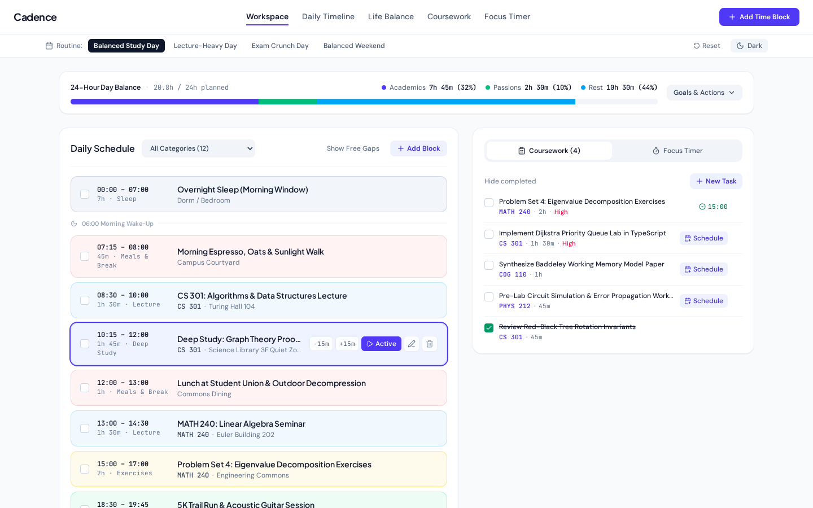
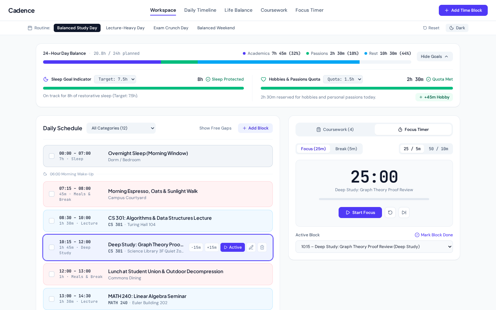
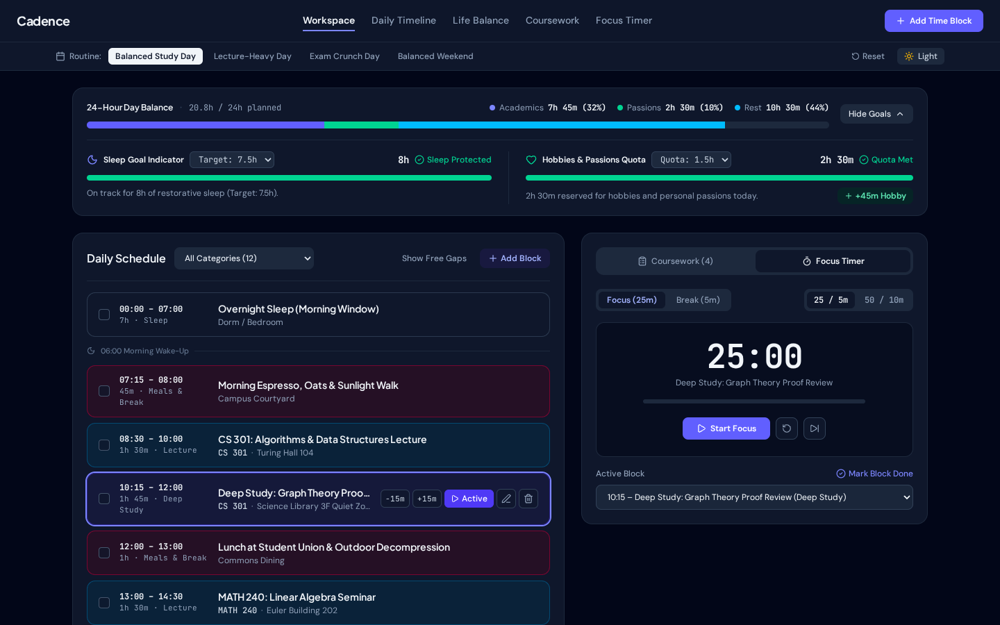

# Cadence — Student Routine & Life-Balance Planner

**Cadence** is a modern, calm, and distraction-free daily routine and time-blocking web application designed for university students. It helps students structure their 24-hour day across lectures, deep study sessions, exercises/problem sets, personal passions, and restorative sleep—preventing academic burnout before it starts.

**Live Application:** [https://cadence-routine-planner.ai.studio](https://cadence-routine-planner.ai.studio)



---

## Screenshots

### 1. Daily Time-Blocking & Coursework Backlog (Light Mode)
Compact 24-hour distribution bar at the top, color-coded daily schedule on the left, and prioritized coursework backlog with one-click slot scheduling on the right.


### 2. Expanded Sleep & Hobby Goals + Built-in Focus Timer
Clicking **Goals & Actions** expands the **Sleep Goal Indicator** and **Hobbies & Passions Quota** panels with target selectors and quick recovery actions, alongside the linked **Pomodoro Focus Timer** (`25 / 5m` and `50 / 10m`).



### 3. Dark Mode Workspace
Full dual-theme support with high-contrast dark surfaces for late-evening planning.



---

## Key Features

- **Interactive 24-Hour Daily Timeline (Time-Blocking)**
  - Visual planner spanning the overnight rest window (`00:00 – 06:00`) and waking schedule (`06:00 – 24:00`).
  - Color-coded categories: *Lectures & Classes*, *Deep Study*, *Exercises & Assignments*, *Hobbies & Passions*, *Meals & Breaks*, and *Sleep & Night Rest*.
  - Hover-revealed quick duration adjustments (`-15m`, `+15m`), optional open-gap indicators (*Show Free Gaps*), category filtering, and automatic schedule overlap detection with one-click **Auto-Fix Overlaps**.

- **Collapsible Life-Balance & Sleep Tracker**
  - Compact 24-hour distribution bar showing real-time hours and percentages across **Academics**, **Passions**, and **Rest**.
  - Expandable **Goals & Actions** drawer featuring a customizable **Sleep Goal Indicator** (`7.0h`–`9.0h` target) and **Hobbies & Passions Quota** (`1.0h`–`3.0h` target) with one-click recovery actions (`Extend Sleep` and `+45m Hobby`).

- **Coursework & Exercise Backlog**
  - Prioritized backlog for problem sets, lab reports, and readings tagged by course code, priority, and estimated duration.
  - One-click **Schedule** button automatically finds the next conflict-free time slot in the daily timeline and links task completion state with the corresponding timeline block.

- **Built-in Focus Timer (Pomodoro)**
  - Clean timer supporting **25 / 5 min** and **50 / 10 min** focus/break cycles.
  - Directly linked to the active study or exercise block so you can mark blocks completed without leaving the timer.

- **Quick Routine Templates & Dual Theme**
  - One-click presets to populate or reset the day: *Balanced Study Day*, *Lecture-Heavy Day*, *Exam Crunch Day*, and *Balanced Weekend*.
  - Full **Light Mode** and **Dark Mode** support with persistent `localStorage` state.

---

## Tech Stack

- **Frontend**: React 19, TypeScript, Tailwind CSS v4
- **Icons**: Lucide React
- **Build Tool**: Vite
- **Unit Testing**: Node.js built-in test runner (`node:test` + `tsx`)

---

## Getting Started

### Prerequisites

- **Node.js** `>= 20.x`
- **npm** `>= 10.x`

### Installation & Local Development

```bash
# 1. Clone the repository
git clone https://github.com/<your-username>/cadence-student-planner.git
cd cadence-student-planner

# 2. Install dependencies
npm install

# 3. Start the development server on http://localhost:3000
npm run dev
```

### Scripts

| Command | Description |
| :--- | :--- |
| `npm run dev` | Starts the local Vite development server on port `3000` |
| `npm run build` | Builds the production bundle into `dist/` |
| `npm run preview` | Previews the production build locally |
| `npm test` | Runs unit tests for time-blocking math, overlap resolution, and balance metrics |
| `npm run lint` | Runs TypeScript type-checking (`tsc --noEmit`) |

---

## Project Structure

```text
├── docs/
│   └── screenshots/            # Application screenshots for README
│       ├── workspace-light.png
│       ├── goals-and-timer.png
│       └── workspace-dark.png
├── index.html                  # App entry HTML & font declarations
├── package.json                # Scripts and dependencies
├── src/
│   ├── App.tsx                 # Main workspace orchestration & localStorage persistence
│   ├── index.css               # Tailwind CSS v4 configuration & custom dark variant
│   ├── main.tsx                # React root mount
│   ├── components/
│   │   ├── TopBar.tsx          # Header navigation and primary Add Block CTA
│   │   ├── BalanceDashboard.tsx# Collapsible 24h distribution bar & sleep/hobby goals
│   │   ├── DailyTimeline.tsx   # Interactive time-blocking list & overlap resolution
│   │   ├── CourseworkBacklog.tsx# Prioritized exercise backlog & 1-click slot scheduler
│   │   ├── FocusTimer.tsx      # Linked 25/5 & 50/10 Pomodoro timer
│   │   └── BlockModal.tsx      # Accessible dialog for creating and editing blocks
│   ├── types/
│   │   └── schedule.ts         # TypeScript interfaces for blocks, tasks, and metrics
│   └── utils/
│       ├── scheduleMath.ts     # Pure functions for time math, overlaps, and balance metrics
│       ├── scheduleMath.test.ts# Automated unit tests (node:test)
│       └── seedData.ts         # Routine templates & realistic sample coursework
└── vite.config.ts              # Vite bundler configuration
```

---

## License

Distributed under the **MIT License**. See [`LICENSE`](./LICENSE) for details.
